  

# 🌐 Awesome-Cross-Browser-Testing-Cloud

  
  
  
  
  
  

## 🚀 Top Cross-Browser Testing Cloud Ecosystem

**A Curated List of SaaS Products & Open-Source Infrastructure Grids**  
*Comprehensive landscape of browser grids, real-device clouds, automated test orchestration, and open-source Selenium/Playwright alternatives.*  
**Last updated: March 2026**

This repository tracks notable **SaaS platforms** and **open-source projects** in the **Cross-Browser Testing Cloud** ecosystem. These platforms provide on-demand access to remote browser instances and physical mobile devices—empowering software engineering and QA teams to run automated and interactive cross-platform tests across thousands of desktop and mobile combinations without the capital overhead of maintaining physical device labs.

**Category Leaders**: BrowserStack, Sauce Labs, LambdaTest (TestMu AI), SmartBear (BitBar), TestingBot, Moon Cloud, and open-source infrastructure like Playwright, Puppeteer, Cypress, Selenium Grid 4, and Selenoid.

---

## 📑 Table of Contents
- [📊 Sector Overview & Market Dynamics](#-sector-overview--market-dynamics)
- [☁️ SaaS & Hosted Commercial Platforms](#️-saas--hosted-commercial-platforms)
- [🔓 Open-Source GitHub Projects & Self-Hosted Grids](#-open-source-github-projects--self-hosted-grids)
- [🛠️ Architectural Guidance for Self-Hosting](#️-architectural-guidance-for-self-hosting)
- [🤝 How to Contribute](#-how-to-contribute)
- [💖 Support & Sponsorship](#-support--sponsorship)
- [📈 Star History](#-star-history)
- [⚠️ Disclaimer](#️-disclaimer)

---

## 📊 Sector Overview & Market Dynamics

The global cross-browser testing tool and cloud infrastructure market is estimated at **$2.8 billion to $3.1 billion**, projected to expand at a **CAGR of ~11.5%** toward exceeding **$5.5 billion by 2030**. 

The sector exhibits **moderate concentration with an oligopolistic top tier** led by heavyweight platforms (BrowserStack, Sauce Labs, and SmartBear) capturing a significant share of large enterprise budgets, while mid-market challengers like LambdaTest and lean specialized providers (TestingBot, TestGrid, Aerokube) compete aggressively on concurrency pricing and AI-driven self-healing test automation. Concurrently, a resilient **open-source and self-hosted tier** (Playwright, Selenium Grid, Selenoid/Moon) remains essential for organizations prioritizing strict data sovereignty, compliance, and predictable cost structures over per-minute cloud billing.

---

## ☁️ SaaS & Hosted Commercial Platforms

*Sorted by company scale (Revenue / Valuation) in descending order.*

| Product | Company Scale (Revenue / Valuation) | Description | Pricing | Free Tier Limits |
|:---|:---|:---|:---|:---|
| **[BrowserStack](https://www.browserstack.com/)** | 🦄 **$4.0B Valuation** / ~$220M ARR | Industry-standard cloud testing platform with 3,000+ desktop browsers and 30,000+ real iOS/Android devices. Supports Selenium, Playwright, Cypress, and Appium with unlimited automated test minutes per slot. | Live from $12.50/user/month (annual); Automate Desktop from $99/month (annual per 1 parallel session) | Free trial: 100 minutes automated testing, 30 minutes Live testing (max 1 min/session, 100 screenshots). Permanent free tier for Percy visual testing (5,000 screenshots/month). Free for open source. |
| **[BitBar (SmartBear)](https://smartbear.com/product/bitbar/)** | 🏢 **$1.8B Valuation** / ~$150M+ ARR (SmartBear) | Enterprise cloud device and desktop browser testing platform. Highly scalable execution grid across real mobile devices and custom CI/CD pipelines. | Live Testing: €45/parallel/month; BitBar Unlimited: €202/parallel/month (annual) | 14-day free trial: full access to real device cloud, browser grids, and parallel execution. Free access for qualifying open-source projects. |
| **[CrossBrowserTesting (SmartBear)](https://smartbear.com/product/crossbrowsertesting/)** | 🏢 **$1.8B Valuation** / ~$150M+ ARR (SmartBear) | Cloud testing platform with 1,500+ desktop and mobile browsers. Acquired by SmartBear and officially retired on July 31, 2023, with workloads consolidated into BitBar. | Historical pricing started at $39/month (Live) to $104/month (Automated) prior to retirement | Platform retired July 31, 2023; users directed to BitBar. Historical trial was 7 days with 100 automated minutes. |
| **[LambdaTest (TestMu AI)](https://www.lambdatest.com/)** | 🦄 **$400M Valuation** / ~$120M–$150M ARR | Feature-packed cloud testing matrix with 10,000+ browser/OS combinations, physical devices, KaneAI test authoring, and HyperExecute test orchestration engine. | Live from $15/month; Web Automation from $79/month (annual per 1 parallel session) | Free forever plan: 100 lifetime automated testing minutes, 60 live testing minutes/month (max 10 min/session), 6 responsive tests/month, and 1 parallel test session. |
| **[Sauce Labs](https://saucelabs.com/)** | 💼 **$250M+ Total Funding** / ~$75M–$95M ARR | Enterprise cloud testing with Virtual Device Cloud (emulators/simulators) and Real Device Cloud. Features automated and manual testing with US & EU secure data centers. | Virtual Device Cloud: $149/month (annual); Real Device Cloud: $199/month (annual); Entry plans from $39/month | 28-day free trial: up to 3 parallel VMs, 60 minutes automated/live testing, access to real devices & emulators, 50 AI test authoring queries. Free for qualifying open source. |
| **[TestGrid](https://testgrid.io/)** | 📈 **~$5M+ ARR** / Multi-million Pre-Series A | Real device cloud featuring AI-powered autonomous testing (CoTester), no-code automation, and self-healing test execution (AgentRx). Supports modern Android/iOS and web matrix. | Starter Package: $199–$249/seat/month (minimum 4 seats bundle, includes 4 browser/device slots & 5,000 AI tokens) | Guided proof-of-concept / demo-gated trial (1–2 weeks, custom trial tokens/minutes upon sales request). No permanent self-serve free tier. |
| **[TestingBot](https://testingbot.com/)** | 💼 **~$1M–$2M ARR** / Bootstrapped ($0 VC) | EU-hosted cloud testing infrastructure with 6,100+ real desktop browsers and physical iOS/Android devices. Flat plan includes real devices, codeless AI, and visual diffs. | $90/month (billed annually) for 1 parallel test; or $50/month for Live-only plan | 14-day free trial: 100 total testing minutes, 60 minutes live testing (5 min/session limit), 1 parallel test. Free forever for open-source: unlimited automated testing, 2 parallel sessions. |
| **[Browserling](https://www.browserling.com/)** | 💼 **~$600K–$1M ARR** / Bootstrapped ($55K Seed) | Interactive online cross-browser testing tool running real desktop browsers on real operating systems inside secure virtual machine sandboxes. | Starter: $9/month (annual); Developer: $19/month; Team: $29/user/month | Free forever plan: interactive sessions strictly capped at 3 minutes per session, limited to Internet Explorer/basic browsers on Windows 7, with session queueing. |
| **[Comparium](https://comparium.app/)** | 💼 **Boutique ISV** / Bootstrapped (Electronic Team) | Cloud-based visual cross-browser testing tool for capturing simultaneous screenshots and side-by-side layout comparisons across a matrix of browsers and OSs. | Standard: $15/month per user (annual) | Free forever plan: basic manual screenshot comparison across select browsers, sequential execution only (no concurrent automated testing), limited screenshot comparisons per month. |
| **[Moon Cloud (Aerokube)](https://aerokube.com/moon/)** | 💼 **Boutique ISV** / Developer Bootstrapped | Managed Kubernetes-native browser automation cloud supporting Selenium, Playwright, Puppeteer, and Cypress with dynamic browser container provisioning. | $5 per parallel session per month (self-hosted / managed Moon) | Moon Assistance Program provides free evaluation license keys of any size for pre-production / development use; Moon open-source version is free (AGPL/Apache). |

---

## 🔓 Open-Source GitHub Projects & Self-Hosted Grids

*Sorted by GitHub Stars_Counts in descending order. Every badge links directly to the repository's stargazers page.*

| Project | Stars_Badge | Description |
|:---|:---|:---|
| **[Playwright](https://github.com/microsoft/playwright)** |  | Microsoft's cross-browser end-to-end automation framework (Apache-2.0). Provides fast, headless, and headed execution across Chromium, WebKit, and Firefox with native parallel test isolation, automatic waiting, and deep trace inspection. |
| **[Puppeteer](https://github.com/puppeteer/puppeteer)** |  | High-level Chrome and Firefox automation library maintained by Google Chrome's DevTools team. Provides a reference implementation for CDP and WebDriver BiDi protocols for cross-browser testing, automated crawling, and pre-rendering. |
| **[Cypress](https://github.com/cypress-io/cypress)** |  | Fast, easy, and reliable testing for anything that runs in a browser (MIT). Direct in-browser architecture supporting Chrome, Edge, Firefox, and Electron with real-time reload, time-travel debugging, and parallel test execution. |
| **[Selenium Grid 4](https://github.com/SeleniumHQ/selenium)** |  | The universal standard reference hub-and-node architecture for distributed WebDriver execution across heterogeneous nodes. Supports W3C WebDriver, distributed tracing, and GraphQL status inspection. |
| **[WebdriverIO](https://github.com/webdriverio/webdriverio)** |  | Next-generation browser and mobile automation test framework for Node.js (OpenJS Foundation). Supports both WebDriver BiDi and CDP protocols, integrating natively with cloud grids and local browsers. |
| **[docker-selenium](https://github.com/SeleniumHQ/docker-selenium)** |  | Official Docker images for Selenium Grid 4 with Chrome, Firefox, and Edge nodes. Ready-to-run containerized hub and node infrastructure for local, CI/CD, and Kubernetes self-hosted clusters. |
| **[Selenoid](https://github.com/aerokube/selenoid)** |  | Ultra-fast, lightweight Golang implementation of the Selenium hub that launches each browser session in an isolated Docker container with instant startup, video recording, and minimal CPU/memory overhead. |
| **[Zalenium](https://github.com/zalando/zalenium)** |  | Docker-based Selenium Grid with on-demand container scaling, live preview, and dashboard created by Zalando. Can redirect overflow traffic to cloud providers (*Note: Archived by Zalando, but widely studied and functional for legacy setups*). |
| **[Ggr (Go Grid Router)](https://github.com/aerokube/ggr)** |  | High-performance Golang load balancer and router for Selenium grids. Routes thousands of incoming browser requests across hundreds of independent Selenoid or Selenium Grid backend hubs. |
| **[Selenoid UI](https://github.com/aerokube/selenoid-ui)** |  | Graphical web dashboard and VNC viewer for Selenoid and Moon clusters. Allows real-time viewing, manual interaction with running browser sessions, and log inspection. |
| **[Moon by Aerokube](https://github.com/aerokube/moon)** |  | Kubernetes-native browser automation platform (Apache-2.0). Dynamically provisions browser pods in Kubernetes or OpenShift for Selenium, Playwright, Puppeteer, and Cypress with high availability and automatic cleanup. |
| **[any-browser-cli](https://github.com/BhalliBhai/any-browser-cli)** |  | Lightweight command-line tool for cross-browser testing across Safari, Chrome, and Firefox from any operating system using Playwright's WebKit build to run Safari tests on Windows and Linux. |

---

## 🛠️ Architectural Guidance for Self-Hosting

When architecting an in-house private browser grid, consider combining:
1. **Routing Layer**: Use **[Ggr](https://github.com/aerokube/ggr)** or an Ingress/Kong gateway to distribute traffic across regional data centers or clusters.
2. **Container Orchestration**: Use **[Moon](https://github.com/aerokube/moon)** on Kubernetes for auto-scaling pods, or **[Selenoid](https://github.com/aerokube/selenoid)** / **[docker-selenium](https://github.com/SeleniumHQ/docker-selenium)** on lightweight VM instances.
3. **Automation Framework**: Standardize on **[Playwright](https://github.com/microsoft/playwright)** or **[Selenium Grid 4](https://github.com/SeleniumHQ/selenium)** depending on your language stack (TypeScript/Python/Java/C#) and protocol needs (CDP vs. WebDriver BiDi).
4. **Visual Monitoring**: Pair with **[Selenoid UI](https://github.com/aerokube/selenoid-ui)** for live session monitoring and VNC debugging during test runs.

---

## 🤝 How to Contribute

We welcome contributions from QA engineers, automation architects, and infrastructure developers! 🌟

1. 🍴 **Fork the repository** to your personal GitHub account.
2. 🌿 **Create a new branch** (`git checkout -b feature/add-new-testing-tool`).
3. ✏️ **Add or edit entries** in `README.md` keeping formatting, badges, company scale, and pricing specifics consistent.
4. 📝 **Follow guidelines**: Keep descriptions objective, specify starting prices and explicit free tier/trial limits, and verify active links.
5. 🚀 **Submit a Pull Request** with a brief summary of the addition or revision.

---

## 💖 Support & Sponsorship

If you find this curated cross-browser testing cloud guide helpful for your team, test architecture, or CI/CD pipelines, please consider supporting the project:

- ⭐ **Star this repository** to help others discover it!
- 🍴 **Fork and share** with fellow developers and QA engineers.
- ☕ **Buy me a coffee & support continuous updates**: [Sponsor Ishan on GitHub](https://github.com/sponsors/ishandutta2007)

Thank you so much for your generosity and for being part of the open test automation community! 🙌

---

## 📈 Star History

---

## ⚠️ Disclaimer

- This list is **community-curated** for educational, architectural, and informational purposes. It is neither an endorsement nor an exhaustive index.
- Cross-browser testing clouds and containerized grids run arbitrary remote browser code. Ensure adequate sandbox isolation, authentication, and network controls to prevent security breaches.
- Pricing, free tiers, trial quotas, and corporate valuations evolve continuously. Always verify the latest numbers on vendor websites before committing enterprise budgets.

---

  <b>Built with ❤️ for test automation architects, QA engineers, and developers worldwide.</b>

